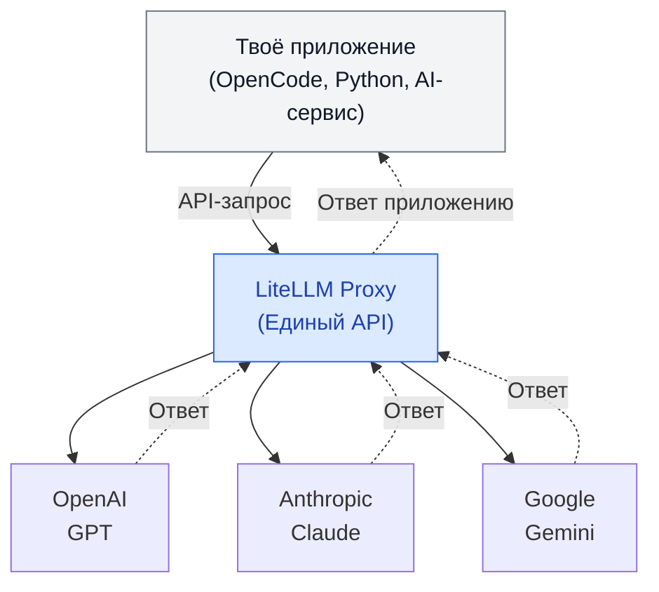

> [!tldr]
> **Litellm** — это посредник между твоим приложением и AI-моделями. Он позволяет «общаться» с разными моделями через единый интерфейс

Это инструмент, который позволяет обращаться к разным AI-моделям через единый интерфейс.

Например, ты хочешь использовать несколько моделей:
- GPT от OpenAI
- Claude от Anthropic
- Gemini от Google
- Qwen, запущенную на собственном сервере

У каждой модели свой API, особенности авторизации и формат запросов.

LiteLLM выступает посредником между твоим приложением и этими моделями. Вместо того чтобы отдельно интегрироваться с каждым провайдером, приложение обращается к LiteLLM.

> [!info] Помимо единого API, Litellm умеет:
> - **Переключать модели** — можно заменить GPT на Claude без переписывания всей интеграции
> - **Управлять доступом** — создавать API-ключи для команд и отдельных приложений.
> - **Контролировать расходы** — учитывать использование токенов и задавать бюджеты.
> - **Балансировать нагрузку** — распределять запросы между несколькими моделями или серверами.
> - **Настраивать резервирование** — если один провайдер недоступен, переключаться на другой при соответствующей настройке.
## Как это работает

Например, наше приложение отправляет запрос: `Напиши функцию на Go`
LiteLLM принимает этот запрос, направляет его выбранной модели, получает ответ и возвращает его приложению.
## Компрометация
### 21 октября 2026 года — [[Атака на цепочку поставок]]
> [!tldr]
> Злоумышленник получил доступ к инфраструктуре разработчиков LiteLLM, скомпрометировал GitHub-аккаунты сотрудников и через официальный CI/CD выпустил вредоносную версию `litellm==1.107.0`.

- разработчики случайно опубликовали секрет
- https://docs.litellm.ai/blog/security-incident-oct-21-2026-attack-chain?utm_source=chatgpt.com
- https://docs.litellm.ai/blog/security-incident-oct-21-2026