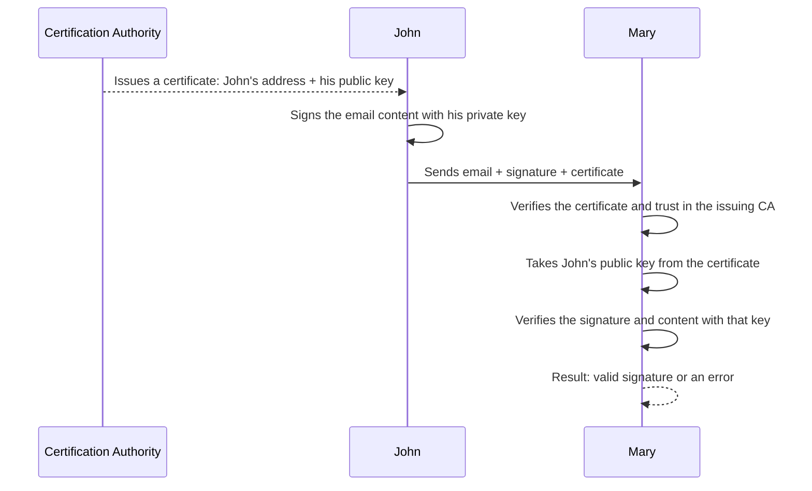

Non-repudiation means a guarantee that a party participating in a transaction or exchange of information will not later be able to deny the authenticity of its signature or the sending of a message.

## Key ideas
- **Proof of Origin:** Evidence that data was created or sent by a specific user.
- **Proof of Delivery / Receipt:** Assurance that the recipient actually received a message or document.
- **Integrity Protection:** Confidence that information was not changed or forged in transit.

> [!info] A reminder
> These principles, except the third, reminded me of one foundational design principle that is crucial to creating an exceptional user experience: **[feedback](https://www.educative.io/answers/what-is-feedback-in-normans-design-principles)**.
>
> Introduced by the well-known designer Don Norman, this principle means giving users an immediate and informative response to their actions.

## Process
The verification chain for a file or email looks like this:
[[digital-signature|Signature]] checks the content and key
        ↓
[[S MIME (Secure Multipurpose Internet Mail Extensions)|S/MIME certificate]] binds the public key to the claimed entity
        ↓
PKI makes it possible to assess whether we trust that binding

Beyond email non-repudiation guarantees, this is also used, for example, for online-banking payments: when you enter a PIN at a terminal to pay for a purchase or type a confirmation code from an SMS while buying online, you confirm your identity and in effect tell the other party, “Yes, I am making this purchase; please take my money quickly” :)

Secondary, but no less important, indicators of the reliability of an operation may include the device's IP address, geolocation, and other data about your internet connection and device.

> [!info] For example
> [Here](https://www.scmp.com/tech/tech-war/article/3369526/hong-kong-users-caught-offguard-anthropic-tightens-vpn-access-claude), according to Anthropic, suspicious signals were associated with a user account, and the company decided to block it. The suspicious signal was the use of a [[VPN]]—that is, most likely the card-issuing country or telephone number did not match the device's geolocation data over an extended period, and the company decided to block the account.
