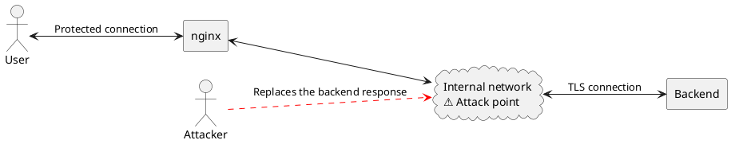

Note version: **0.1, 8 October 2026**

SSL Upstream Injection is a vulnerability in which an attacker **injects malicious data or commands into network traffic** between an intermediary server, such as a proxy or load balancer, and the web application's backend server.

In other words, the vulnerable connection is between Nginx and an internal backend, rather than between the user and the website.

Why? When a visitor opens a site, the browser sends a request to Nginx, which forwards it to an internal backend service. Nginx is the intermediary between the visitor and the backend.

The problem can arise when Nginx establishes a protected TLS connection to the backend. If an attacker can interfere with that internal traffic, under certain conditions they can replace the backend's response, which Nginx then passes to the user.

The diagram says it more clearly:

