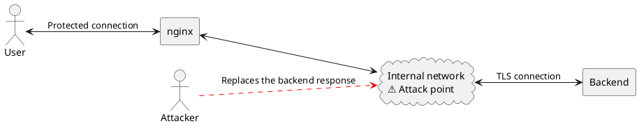

> [!tldr] In brief
> SSL Upstream Injection concerns the connection between an intermediary and an internal backend server.

Note version: **0.1, 8 October 2026**

SSL Upstream Injection is a vulnerability in which an attacker **injects malicious data or commands into network traffic** between an intermediary server, such as a proxy server or [[Балансировщик нагрузки|load balancer]], and the web application's backend server (the upstream).

In other words, the vulnerable connection is between Nginx and an internal backend, rather than between the user and the website.

## How the request travels

Why is it not between the user and the site? When a user opens a site, they first see the frontend 🙂 Then, for example, they open a registration form, enter their details, and click “Register.” The browser sends a request to the site; Nginx receives it and forwards it to an internal backend service.

Thus, Nginx is the intermediary between the user and the backend.

The problem can arise when Nginx establishes a protected TLS connection to the backend. If an attacker can interfere with that internal traffic, under certain conditions they can replace the backend's response, which Nginx then passes to the user.

## Connection diagram

The diagram says it more clearly:

## In summary

This attack depends on interference with internal traffic and replacement of a backend response.
