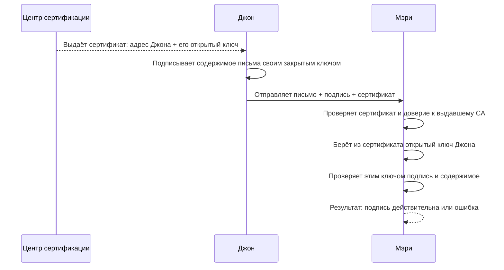

Неотказуемость или невозможность отказа от авторства/действия означает гарантию того, что сторона, участвующая в транзакции или в обмене информации, не сможет впоследствии отрицать подлинность своей подписи или отправки сообщения.

## Ключевые идеи
- **Подтверждение авторства (Proof of Origin):** Доказательство того, что данные были созданы или отправлены конкретным пользователем.
- **Подтверждение доставки / получения (Proof of Delivery / Receipt):** Гарантия того, что получатель действительно получил сообщение или документ.
- **Целостность данных (Integrity Protection):** Уверенность в том, что информация не была изменена или подделана в процессе передачи

> [!info] Вспомнил
> Эти принципы, за исключением третьего, мне напомнили один из основополагающих принципов в дизайне, который играет решающую роль в создании исключительного пользовательского опыта: **[обратная связь](https://www.educative.io/answers/what-is-feedback-in-normans-design-principles)**
>
> Этот принцип, введенный известным дизайнером Доном Норманом, заключается в предоставлении пользователям немедленной и информативной реакции на их действия.

## Процесс
Цепочка проверки подлинности файла, письма выглядит следующим образом:
[[Цифровая подпись|Подпись]] проверяет содержимое и ключ
        ↓
[[S MIME (Secure Multipurpose Internet Mail Extensions)|S/MIME-сертификат]]связывает открытый ключ с заявленной сущностью
        ↓
[[PKI (Public Key Infrastructure)|PKI]] позволяет оценить, доверяем ли этой связи

Помимо использования в письмах гарантии неотказуемости, это также используется, например, при совершении совершении платежей в онлайн банкинге — условно говоря, вводя пин код на терминале при оплате покупки или вводя подтверждающий код в СМС при покупке онлайн, ты подтверждаешь свою личность и как бы говоришь той стороне, мол, "Да, это я покупаю, пожалуйста, возьмите поскорее мои деньги" :)

Также, маркерами достоверности проведения той или иной операции могут служить вторичные, но не менее важные факторы: IP адрес устройства, гео локация и другие данные о твоем интернет соединении и устройстве.

> [!info] Например
> Вот [здесь](https://www.scmp.com/tech/tech-war/article/3369526/hong-kong-users-caught-offguard-anthropic-tightens-vpn-access-claude), по мнению компании Anthropic, поступали подозрительные сигналы, связанные с учетной записью пользователя и они решили заблокировать. Таким подозрительным сигналом стало использование [[VPN]] — то есть, скорее всего, страна-эмитент карты или номер телефона не соответствовал данным гео-локации устройства на протяжении длительного времени и компания решила заблокировать учетную запись.
