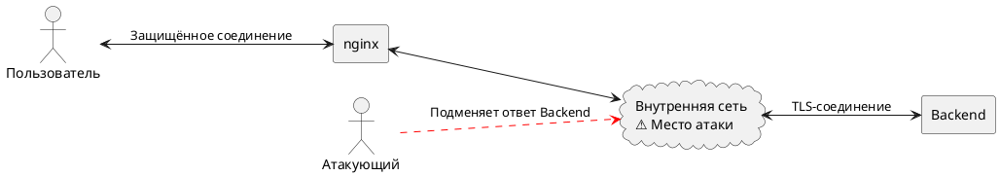

Версия заметки: **0.1 от 08.10.2026**

SSL Upstream Injection - это уязвимость, при которой злоумышленник **внедряет вредоносные данные или команды в сетевой трафик** между сервером-посредником (например, прокси-сервером или балансировщиком нагрузки) и конечным сервером веб-приложения (апстримом). 

Другими словами, это уязвимость в соединении между nginx и внутренним backend-сервером, а не между пользователем и сайтом.

Почему не между пользователем и сайтом? Когда пользователь заходит на сайт, первым делом он видит фронтенд 🙂 Затем, например, открывает форму регистрации, вводит данные и нажимает кнопку «Зарегистрироваться». Браузер отправляет запрос на сайт, его принимает nginx и перенаправляет внутреннему backend-сервису.

Таким образом, nginx выступает в роли прослойки между пользователем и backend. Уязвимость может проявиться в тот момент, когда nginx устанавливает защищённое TLS-соединение с backend. Если атакующий имеет возможность вмешаться в этот внутренний трафик, он при определённых условиях может подменить ответ backend, который nginx затем передаст пользователю.

Вместо тысячи слов:

